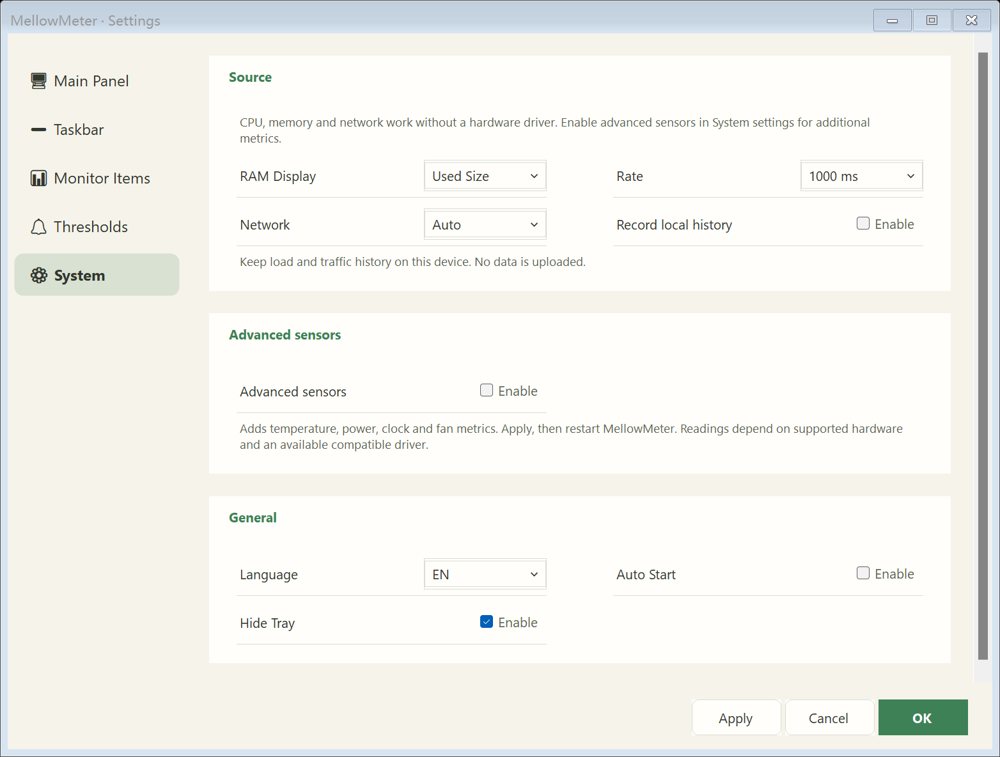

<div align="center">

# MellowMeter

**A calm, compact monitor for your Windows desktop and taskbar.**

[](https://github.com/seiya058904/MellowMeter/releases/tag/v0.1.0)
[](#downloads)
[](LICENSE)

[Download](#downloads) · [Preview](#preview) · [Use](#quick-start) · [Develop](#development)

English · [简体中文](README.zh-CN.md)

</div>

MellowMeter is an independent derivative of [LiteMonitor by Diorser](https://github.com/Diorser/LiteMonitor). It keeps the original WinForms monitor and its floating-panel/taskbar layout, with a quieter default setup, rounded settings, and coordinated themes.

## At a glance

<table>
<tr>
<td width="50%"><strong>See the essentials</strong><br>CPU busy time, memory load, and upload/download rates appear by default in the desktop panel and taskbar strip.</td>
<td width="50%"><strong>Keep the original feel</strong><br>The floating and taskbar layouts, DarkFlat Classic theme, colorful values, and round progress indicators remain.</td>
</tr>
<tr>
<td><strong>Make it yours</strong><br>Rounded settings, pill switches, optional sections, and light/dark theme variants keep common choices close at hand.</td>
<td><strong>Stay in control</strong><br>Basic monitoring uses Windows APIs. Advanced sensors are opt-in; history stays local, with CSV export for hardware trends.</td>
</tr>
</table>

## Preview

<div align="center">


*The original floating panel, with the default four metrics.*


*Settings use the selected theme. More renderer captures are in [`docs/screenshots`](docs/screenshots/).*



</div>

These are captures from the actual WinForms renderer. Some use seeded example readings and `DrawToBitmap`; they are not physical desktop screenshots or performance measurements.

## Quick start

1. Download and extract the complete ZIP folder.
2. Open the extracted folder and run **MellowMeter.exe**.
3. Right-click the panel or taskbar strip to open display controls, history, and settings. Double-click the floating strip to expand it.

The portable ZIP includes the .NET 8 runtime. No SDK, administrator access, or additional driver is needed for basic monitoring. Keep the extracted folder intact when running the app. The Windows executable is currently unsigned, so Windows may show its usual download warning.

## Downloads

| Asset | Description |
| --- | --- |
| [MellowMeter 0.1.0 · Windows x64](https://github.com/seiya058904/MellowMeter/releases/download/v0.1.0/MellowMeter-0.1.0-win-x64.zip) | Portable ZIP with .NET 8 runtime; extract the full folder before running. |
| [SHA256SUMS.txt](https://github.com/seiya058904/MellowMeter/releases/download/v0.1.0/SHA256SUMS.txt) | SHA-256 checksum for verifying the release archive. |

See the [v0.1.0 release page](https://github.com/seiya058904/MellowMeter/releases/tag/v0.1.0) for release notes and assets.

<details>
<summary>Advanced monitoring and data</summary>

- GPU, temperature, disk, clock, power, and fan readings are optional. Enable them under **Settings → System**, apply, then restart. Availability depends on hardware, permissions, and a compatible driver; MellowMeter does not install drivers.
- A missing reading is shown as **—**. Basic CPU, memory, and network monitoring does not require a hardware driver.
- History and CSV exports stay on this PC. Monitoring data is not uploaded.
- CPU reports processor busy time. Network auto mode selects the busiest eligible adapter; rates include local and SMB traffic.
- Plugins, FPS tools, web serving, updater, and speed tests are not part of this release's normal interface or startup path.

</details>

<a id="development"></a>
<details>
<summary>Development</summary>

MellowMeter uses C#, .NET 8, and Windows Forms. Development requires Windows 10/11 x64 and the .NET 8 SDK. Close the running app before rebuilding.

```powershell
# Optional: set up a user-local .NET SDK
.\scripts\setup.ps1

# Build and run
.\scripts\run.ps1

# Open settings directly
.\scripts\run.ps1 -NoBuild -Settings

# Build and run regression checks
.\scripts\build.ps1 -Test

# Build the portable ZIP and SHA-256 file (PowerShell 7.4+)
.\scripts\package.ps1
```

Packaging writes to `artifacts/release` and refuses to overwrite it. Use `-OutputDirectory artifacts/another-release` for a subsequent build. Runtime licenses and third-party notices are included automatically.

Settings and history are stored under `%LOCALAPPDATA%/MellowMeter`. See [design notes](docs/DESIGN.md), [verification and limitations](docs/VERIFICATION.md), and [third-party notices](THIRD_PARTY_NOTICES.md).

</details>

## Verification and limitations

The project has been exercised on Windows 11 x64. The latest recorded local run passed 371 desktop assertions with 37 captures; the six-suite Windows CI run passed. This is release verification, not a guarantee for every device.

Synthetic renderer checks cover 100%, 150%, and 200% scales; host captures were made at 175%. Physical DPI transitions, mixed-DPI monitors, real sleep/wake, Explorer restarts, and broad hardware/driver compatibility have not been verified. The recorded benchmark is a single short comparison and does not establish general performance gains. Details and methods are in [VERIFICATION.md](docs/VERIFICATION.md).

## Upstream and license

Based on LiteMonitor commit [`3b91b5ca6d70a9056b8fdd01c9acddc985721240`](https://github.com/Diorser/LiteMonitor/commit/3b91b5ca6d70a9056b8fdd01c9acddc985721240). Original project history, source namespaces, themes, and relevant resources are retained. MellowMeter is independent and is not an official LiteMonitor release. LiteMonitor declares MIT; see [LICENSE](LICENSE) and [THIRD_PARTY_NOTICES.md](THIRD_PARTY_NOTICES.md) for attribution and dependency terms.
