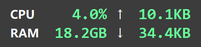
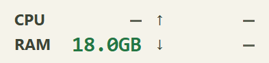
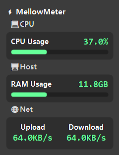
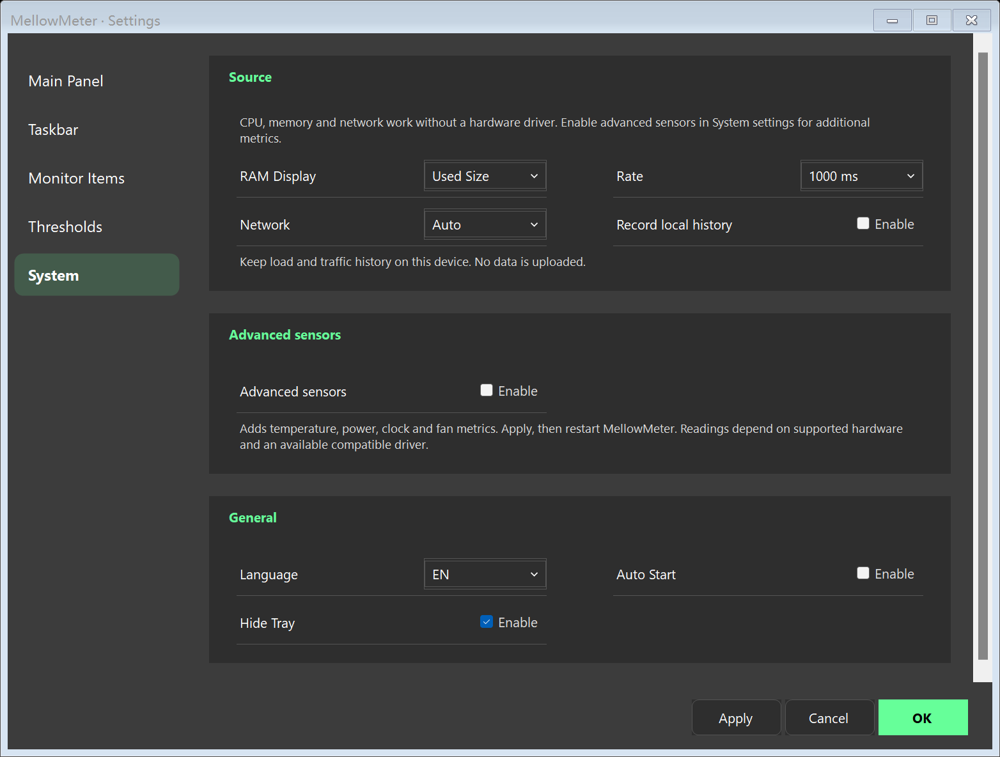
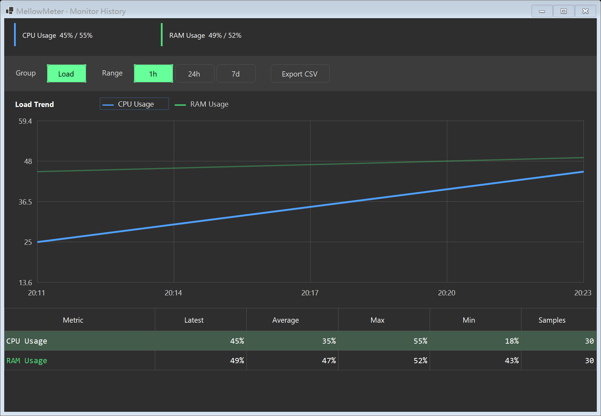

# MellowMeter

A calm, compact Windows desktop and taskbar monitor, thoughtfully refined from [LiteMonitor by Diorser](https://github.com/Diorser/LiteMonitor).

MellowMeter preserves the original WinForms layout and hardware-monitoring foundation. It focuses on readable information, a quieter default experience, and honest measurements rather than more features.



## Everyday monitoring

- **Desktop strip and taskbar strip:** CPU busy time, memory and upload/download rates by default. Double-click the desktop strip to expand it into the original grouped panel; right-click for display controls, history and settings.
- **The original look, kept:** DarkFlat Classic and the original taskbar typography remain the defaults. Existing layouts, colorful values, small icons and round progress bars are preserved. Settings, menus and history now follow the selected theme. Optional Mellow Dark/Light variants add subtle warmer neutrals.
- **Driver-free basic mode:** CPU, memory and network use Windows APIs. No administrator request, driver installer, FPS helper, plugin worker, web service or update request is started by default.
- **Optional advanced sensors:** enable them in **Settings > System**, apply, then restart. GPU, temperature, disk, clock, power and fan metrics depend on supported hardware, permissions and an available compatible driver. Missing readings show **—**; MellowMeter does not install drivers for you.
- **Local history:** retained load/temperature trends, traffic history and CSV export. Recording can be paused without deleting old records. No monitoring data is uploaded.
- **Resident behavior:** tray controls, optional per-user startup, display/DPI recovery and taskbar recreation. Sampling pauses during suspend; locked/hidden views use a 10-second history cadence, or stop sampling when history is disabled. Battery operation uses at least a 2-second interval.

Plugins, web serving, FPS, speed tests and memory cleanup remain in the inherited source for provenance, but are outside this version's normal interface and startup path. The upstream updater is not shipped or called.

## Build and run

Windows 10/11 x64 and the **.NET 8 SDK** are required for development. No additional hardware driver is required for basic monitoring.

```powershell
# Optional: install a user-local SDK without changing global PATH
.\scripts\setup.ps1

# Build and start the actual Windows application
.\scripts\run.ps1

# Open its settings directly
.\scripts\run.ps1 -NoBuild -Settings

# Build and run the regression checks
.\scripts\build.ps1 -Test
```

If .NET is already on PATH, standard commands work too:

```powershell
dotnet build MellowMeter.csproj -c Release
dotnet run --project MellowMeter.csproj -c Release
```

The build output is `bin/Release/net8.0-windows/MellowMeter.exe`. The scripts also recognize the local SDK at `%LOCALAPPDATA%/MellowMeter/dotnet`. A framework-dependent executable needs the .NET 8 Desktop Runtime or the SDK; use `run.ps1` when using the local SDK.

Settings and histories live in `%LOCALAPPDATA%/MellowMeter`, separate from LiteMonitor. For isolated verification or portable profiles, set `MELLOWMETER_DATA_DIR` before launching. Startup is opt-in and uses only the current user's `MellowMeter` Run entry; changing ordinary settings does not register a startup task.

## Screenshots






Panel and form captures are produced from the real WinForms renderer. `DrawToBitmap` captures may differ from desktop window chrome and region clipping. Expanded-panel and history regression captures contain seeded example data; they are not performance measurements. The upstream gallery remains under `resources/screenshots` and is not presented as MellowMeter artwork.

## Engineering and verification

The project remains **C# / .NET 8 / Windows Forms**. Existing renderer, themes, history and LHM hardware handling are reused. Native basic sampling avoids opening the hardware tree until advanced monitoring is explicitly enabled; elapsed time and rate baselines use a monotonic clock. Displayed numbers represent samples rather than multi-second interpolation. No forced collection or working-set trimming runs in the monitor.

See [verification and measured limitations](docs/VERIFICATION.md) for local test evidence, benchmark methodology and scenarios that still need physical-device testing. `scripts/Measure-Process.ps1` records per-process startup, CPU, working set, private bytes and handles without forcing collection. It requires PowerShell 7.4 or newer. GitHub Actions builds on Windows and runs native, desktop and inherited core regressions.

CPU represents processor **busy time**, which can differ from Task Manager's frequency-weighted utility. Network auto mode chooses the busiest eligible adapter, avoiding double-counting an underlying NIC and VPN; explicit adapter selection never silently substitutes a missing device. Rates include local/SMB traffic.

## Upstream and dependencies

Based on LiteMonitor commit [`3b91b5ca6d70a9056b8fdd01c9acddc985721240`](https://github.com/Diorser/LiteMonitor/commit/3b91b5ca6d70a9056b8fdd01c9acddc985721240). Original Git history, source namespaces, themes and relevant resources are retained. MellowMeter is an independent derivative, not an official LiteMonitor release. `upstream` points to Diorser/LiteMonitor; `origin` points to this project's repository.

The pinned direct dependencies are LibreHardwareMonitorLib **0.9.6** and System.Text.Json **9.0.10**, inherited unchanged. See [THIRD_PARTY_NOTICES](THIRD_PARTY_NOTICES.md) for licenses and source links. Application source is MIT-licensed; LiteMonitor's upstream README explicitly declares MIT. Dependency licenses continue to apply independently.
