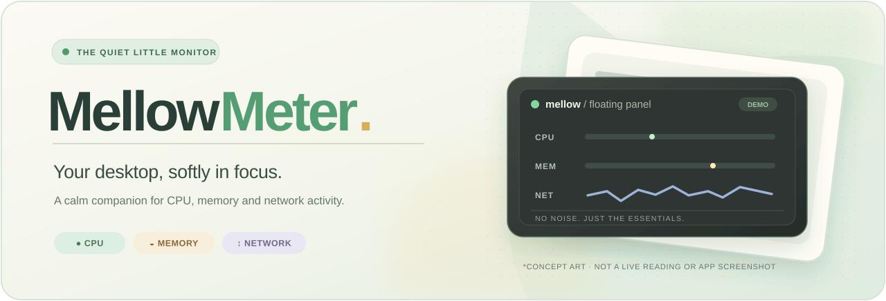
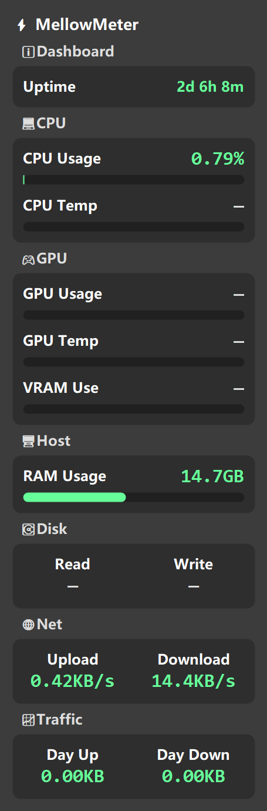
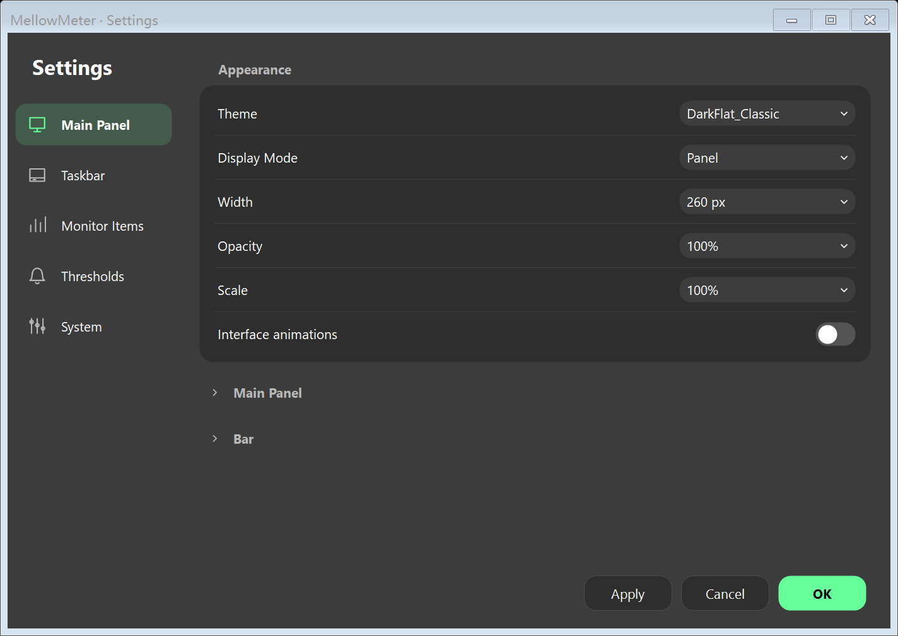
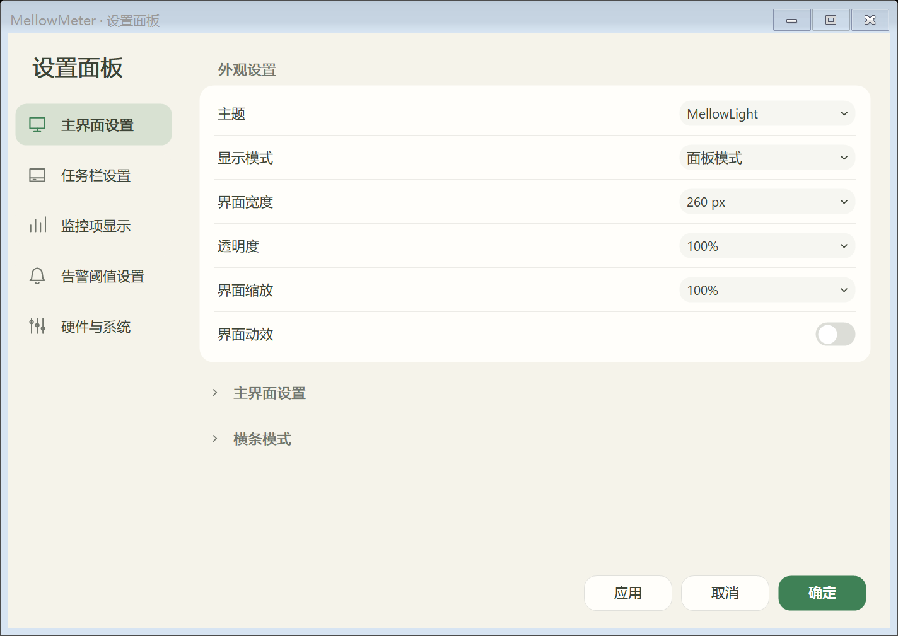
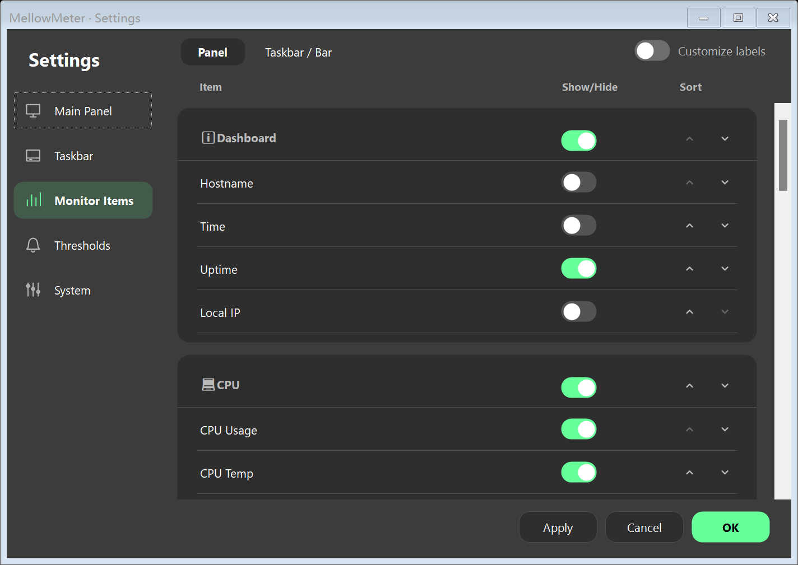
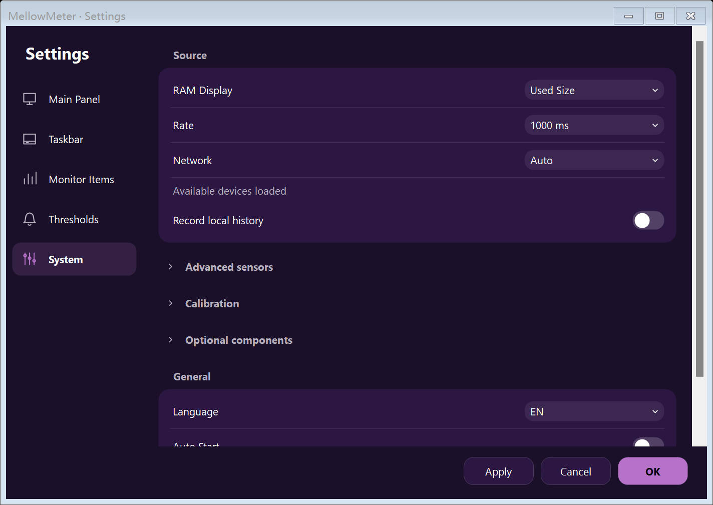
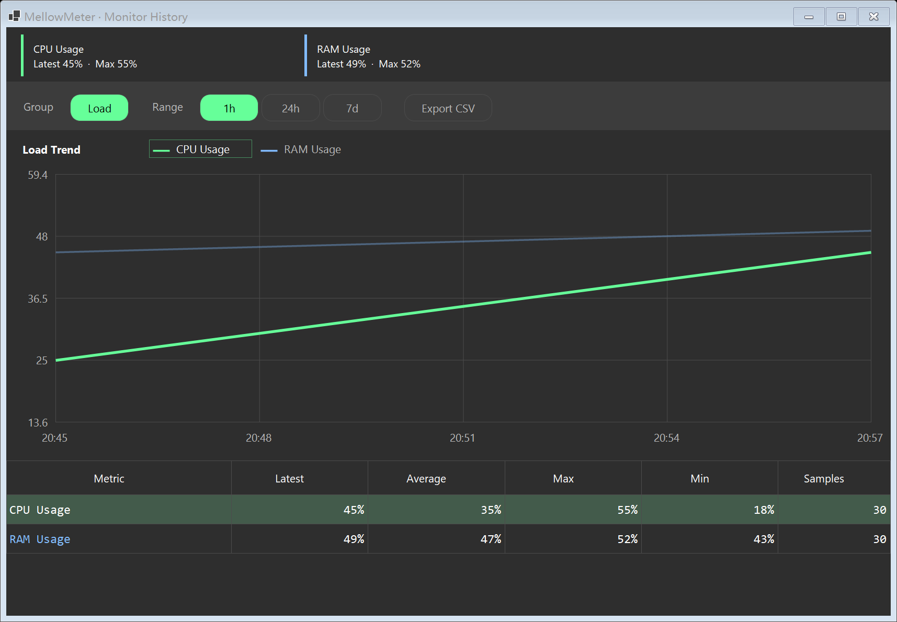

<p align="center">
  <a href="https://github.com/seiya058904/MellowMeter/releases/latest">
    
  </a>
</p>

<h1 align="center">MellowMeter</h1>

<p align="center">
  <strong>A little quieter. A lot more aware.</strong><br />
  A small native Windows monitor for the things worth keeping an eye on — without taking over your desktop.
</p>

<p align="center">
  <a href="https://github.com/seiya058904/MellowMeter/releases/tag/v0.2.0"></a>
  
  
  <a href="LICENSE"></a>
</p>

<p align="center">
  <a href="https://github.com/seiya058904/MellowMeter/releases/latest"><strong>↓ Download for Windows</strong></a>
  &nbsp;·&nbsp; <a href="#preview">Screenshots</a>
  &nbsp;·&nbsp; <a href="#features">Features</a>
  &nbsp;·&nbsp; <a href="#quick-start">Get started</a>
  &nbsp;·&nbsp; <a href="#development">For developers</a>
</p>

<p align="center"><sub>Portable or Lite ZIP · 32 selectable metrics · Local history</sub></p>
<p align="center"><sub>English · <a href="README.zh-CN.md">简体中文</a> · <a href="https://github.com/seiya058904/MellowMeter/issues">Issues &amp; feedback</a></sub></p>

---

MellowMeter builds on **[LiteMonitor](https://github.com/Diorser/LiteMonitor)**, retaining its compact floating monitor, taskbar layout, colorful readings, and familiar themes. It adds refined grouped settings, local history, and coordinated light/dark styling — without trying to become a full dashboard.

**v0.2.0:** All **32 built-in monitoring items**, **12 themes**, and the original panel/taskbar selections. Settings now create pages on demand, reuse metric editors and apply only changed settings. Solid rounded groups and optional light feedback keep the interface consistent. See the [measured results and remaining limits](docs/settings-fluid-20261030.md).

<a id="features"></a>

## 🌿 A small space for the essentials

<table>
<tr>
<td width="50%" valign="top">
<strong>📊 32 metrics. Your selection.</strong><br /><br />
Choose CPU, GPU, memory, disk, network, battery and more. The default vertical panel selects 13 items; the taskbar selects six. Unavailable values stay clearly marked.
</td>
<td width="50%" valign="top">
<strong>🪟 Right where you need it.</strong><br /><br />
Keep a floating desktop panel or use the taskbar strip. Expand the floating strip when you want to see a little more.
</td>
</tr>
<tr>
<td valign="top">
<strong>🎨 Your colors, your pace.</strong><br /><br />
Soft rounded settings, pill switches, collapsible groups, and coordinated themes sit alongside the original DarkFlat Classic look.
</td>
<td valign="top">
<strong>🗂️ History that stays yours.</strong><br /><br />
Review local monitoring history and export hardware trends as CSV. Advanced sensors are enabled in new profiles; turn them off for basic Windows API monitoring. Availability depends on hardware and installed components.
</td>
</tr>
</table>

<a id="preview"></a>

## 🖼️ A closer look

<p align="center">
  
</p>
<p align="center"><sub>The vertical panel — configurable metrics and clear unavailable readings</sub></p>

<table>
<tr>
<td width="50%" align="center" valign="top">
  <br />
  <sub>Dark settings</sub>
</td>
<td width="50%" align="center" valign="top">
  <br />
  <sub>Light settings</sub>
</td>
</tr>
</table>

<details>
<summary><strong>✨ More looks — monitor settings, themes &amp; history</strong></summary>

<p align="center">
  
</p>
<p align="center"><sub>Grouped monitor settings</sub></p>

<table>
<tr>
<td width="50%" valign="top" align="center">
  <br />
  <sub>AuroraDream Purple</sub>
</td>
<td width="50%" valign="top" align="center">
  <br />
  <sub>Local history</sub>
</td>
</tr>
</table>

Browse the [screenshot collection](docs/screenshots/) for more theme and taskbar captures.

</details>

<sub><strong>About these images:</strong> They come from the actual WinForms renderer. Some use seeded example readings and <code>DrawToBitmap</code>; they are not physical-desktop screenshots or performance measurements. The illustrated cover above is concept art. See the <a href="docs/VERIFICATION.md">verification record</a> for the exact capture conditions.</sub>

<a id="quick-start"></a>

## 📦 Download. Extract. Relax.

| Download | Details |
| :--- | :--- |
| **[MellowMeter v0.2.0 · Windows x64 portable ZIP](https://github.com/seiya058904/MellowMeter/releases/download/v0.2.0/MellowMeter-0.2.0-win-x64.zip)** | **70.6 MiB**, includes the .NET 8 runtime. No separate SDK required. |
| **[MellowMeter v0.2.0 · Windows x64 Lite ZIP](https://github.com/seiya058904/MellowMeter/releases/download/v0.2.0/MellowMeter-0.2.0-win-x64-lite.zip)** | **2.73 MiB**, same features; requires the installed .NET 8 Desktop Runtime x64. |
| [SHA256SUMS.txt](https://github.com/seiya058904/MellowMeter/releases/download/v0.2.0/SHA256SUMS.txt) | Compare the archive's SHA-256 hash with the published checksum. |
| [Release notes](https://github.com/seiya058904/MellowMeter/releases/tag/v0.2.0) | Changes, downloads, and release verification. |

**Three steps to start:**

1. Download the portable ZIP and **extract the entire folder** to a location of your choice.
2. Open the folder and run **`MellowMeter.exe`**.
3. **Right-click** the panel or taskbar strip for display options, settings, and history. **Double-click** the floating strip to expand it.

The application targets **Windows 10/11 x64**; the recorded physical host test was on **Windows 11 x64**. Basic CPU, memory, and network monitoring needs neither administrator access nor an additional hardware driver. The EXE is currently **unsigned**, so Windows may display its normal reputation warning. Keep the extracted package together when running the app.

<a id="how-it-works"></a>

## 🎛️ Make it feel like your desktop

**The familiar layout, with gentler controls.** MellowMeter preserves the original floating/taskbar views, colorful values, circular progress indicators, and DarkFlat Classic theme. Rounded groups, disclosure sections, and pill switches make it easier to adjust the essentials. Theme changes apply across open settings and history windows.

| What | How it behaves |
| :--- | :--- |
| **Default metrics** | 32 selectable items; 13 selected in the vertical panel and six in the taskbar. New profiles use DarkFlat Classic. |
| **Advanced sensors** | Enabled in new profiles and switchable in **Settings → System**. Apply and restart after changing this option. Hardware, permissions, and compatible drivers determine availability. |
| **Unavailable readings** | Shown as **—** rather than guessed or silently replaced. Driver and FPS component installation is manual, from **Settings → System**; nothing is installed automatically. |
| **Network rates** | Automatic selection uses the busiest eligible adapter, not a sum across all interfaces; local and SMB traffic may be included. |
| **History** | Stored on your PC, with CSV export for hardware trends. Monitoring data is not uploaded. |

<details>
<summary><strong>What is deliberately outside the normal v0.2.0 experience?</strong></summary>

Plugins, web serving, automatic updating, and speed tests are excluded. FPS is available through an explicitly installed optional component. CPU reports processor <em>busy time</em>, which is not the same as frequency-weighted CPU utility. For hosts with more than 64 logical processors, the collector has a [documented processor-group limitation](docs/VERIFICATION.md#measurement-limits).

</details>

<a id="development"></a>

## 🛠️ Build it yourself

**C# · Windows Forms · .NET 8 · PowerShell**

Development requires Windows 10/11 x64 and the .NET 8 SDK. Close the running application before rebuilding.

```powershell
# Optional: set up a user-local .NET SDK
.\scripts\setup.ps1

# Build and run
.\scripts\run.ps1

# Open settings directly
.\scripts\run.ps1 -NoBuild -Settings

# Build and run regression checks
.\scripts\build.ps1 -Test

# Build the portable ZIP and its SHA-256 file (PowerShell 7.4+)
.\scripts\package.ps1

# Or build both Portable and Lite; Lite requires .NET 8 Desktop Runtime x64
.\scripts\package.ps1 -Mode Both -OutputDirectory artifacts/release-both
```

<details>
<summary><strong>Build outputs, app data &amp; implementation notes</strong></summary>

Packaging writes to `artifacts/release` and refuses to overwrite an existing directory. Use `-OutputDirectory artifacts/another-release` for a later build. Runtime licenses and third-party notices are included in the package. Settings and history are stored under `%LOCALAPPDATA%/MellowMeter`.

Further reading: [design direction](docs/DESIGN.md) · [verification and limitations](docs/VERIFICATION.md) · [third-party notices](THIRD_PARTY_NOTICES.md).

</details>

## 🧪 Tested — with the edges clearly marked

The current Windows 11 x64 build is checked with **four regression suites**, native package interaction, both package variants and a three-round settings performance comparison. See the [current verification report](docs/settings-fluid-20261030.md) for exact results, source/binary identity and exceptions. Published CI results are available in [Actions](https://github.com/seiya058904/MellowMeter/actions/workflows/build.yml).

| Covered | Not established by these checks |
| :--- | :--- |
| Windows 11 host checks, render/interaction regressions, and portable package smoke test | Universal Windows 10 and hardware compatibility |
| Synthetic renderer scaling at 100%, 150%, and 200%; host captures at 175% | Physical DPI switching, mixed-DPI monitors, and HDR-like display differences |
| Simulated lock/suspend/hidden-state transitions | Physical sleep/wake, Explorer restart, and varied sensor/driver environments |
| Three measured rounds against the preceding MellowMeter settings | Universal sub-100 ms interactions or long-term stability across machines |

Read the [full verification record](docs/VERIFICATION.md) for methods, limits, and the benchmark context.

## 🌱 Made from a good idea

MellowMeter is an **independent derivative** of [Diorser's LiteMonitor](https://github.com/Diorser/LiteMonitor), based on upstream commit [`3b91b5ca`](https://github.com/Diorser/LiteMonitor/commit/3b91b5ca6d70a9056b8fdd01c9acddc985721240). Original project history, namespaces, themes, and relevant resources are preserved. It is **not an official LiteMonitor release**.

Licensed under **[MIT](LICENSE)**. Original attribution and bundled dependency terms are documented in [THIRD_PARTY_NOTICES.md](THIRD_PARTY_NOTICES.md).

---

<p align="center">
  <strong>Keep an eye on what matters. Let the rest stay mellow.</strong><br />
  <a href="https://github.com/seiya058904/MellowMeter/releases/latest">Download MellowMeter</a>
  &nbsp;·&nbsp; <a href="#mellowmeter">Back to top ↑</a>
</p>
