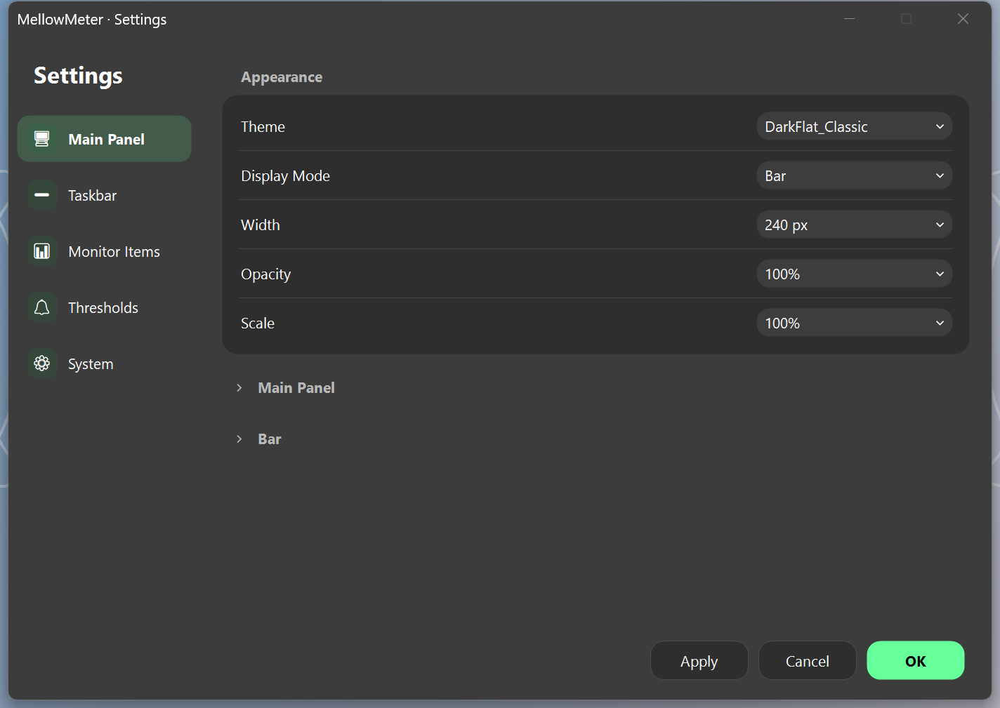
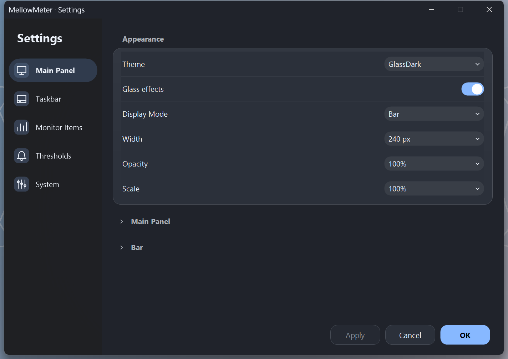
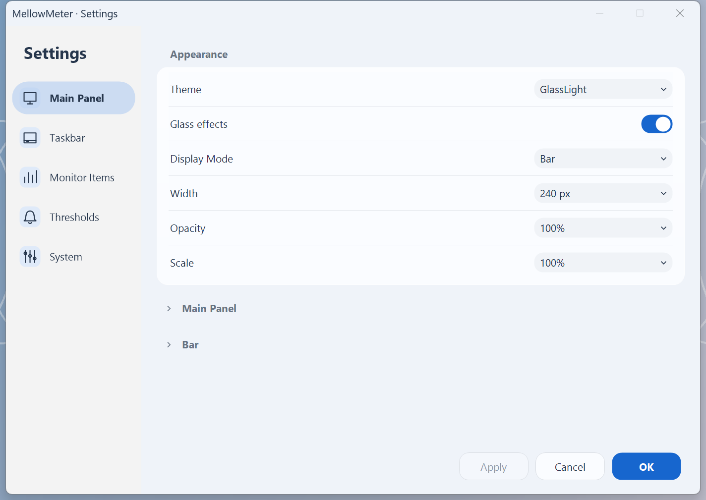
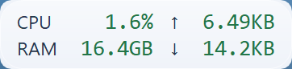

# MellowMeter 0.2 local iteration

This is a local Windows x64 delivery, not a published release. Dependency versions are unchanged. Source work stays within WinForms and the existing monitoring/history architecture.

## What changed

- **14 themes:** the twelve previous themes plus Glass Light and Glass Dark. Fresh profiles use Glass Light; existing profiles retain their selected theme. Optional `material` and accent fields remain backward compatible.
- **Material and layout:** a native Mica settings sidebar on Windows 11 build 22621+, rounded selected navigation, drawn line icons, restrained blue actions, grouped controls and solid data surfaces. Main strips and expanded cards use a small bounded cache of gradients/highlights. Taskbar integration keeps its layered-window behavior.
- **Settings:** pages build on first visit and are reused. Drafts, scroll, disclosure state and monitor tabs/label-editor state survive navigation and appearance rebuilds. Apply follows effective changes, including monitor rows and reverted edits. Sorting buttons expose accessible names and disabled states. Hardware enumeration distinguishes loading, failure and no devices.
- **Rendering:** a display signature avoids unchanged monitor repainting. Explorer handle/placement checks run separately from data events. Charts cache ordered timestamps and coordinates; hover uses binary search, while dense traces retain first/last/low/high points per pixel column. Statistics and CSV continue to use full input data. Minimized history windows stop UI refresh without stopping recording.
- **Retired surface:** pump/case fan readings, manual fan selection and manual maximum calibration. CPU/GPU fans and automatic ranges remain. Plugin, FPS, web server, speed-test, updater and driver-installer implementations remain in the repository but are excluded from the executable and package. Their service calls and timers are disconnected.
- **Migration:** the first schema migration preserves the loaded source as `settings.pre-v0.2.json` before changes. It never replaces that backup. Theme, placement, aliases, ordering and history are retained; retired flags cannot start excluded modules.

Windows transparency, high contrast, battery saver and the app's own opt-out disable effects. Turning system transparency back on does not override an explicit app opt-out. Mica is a wallpaper-derived Windows material, not a continuously blurred view of other windows. Layered floating/taskbar windows use the drawn fallback; no surface uses continuous CPU blur, refractive animation or a new framework. See [Microsoft's documented backdrop types](https://learn.microsoft.com/en-us/windows/win32/api/dwmapi/ne-dwmapi-dwm_systembackdrop_type) and the [design contract](DESIGN.md).

## Desktop evidence

The local desktop is Windows 11 Enterprise 22631, 3840 × 2160 at 175% / 168 DPI. Captures use actual displayed window pixels (`CopyFromScreen`) from an isolated app profile. Bright, dark and patterned background windows test contrast without replacing the user's wallpaper. They do not establish how Mica reacts to three different actual wallpapers.

| Before: v0.1 dark | Glass Dark | Glass Light |
| --- | --- | --- |
|  |  |  |

Additional desktop captures: [expanded panel](screenshots/v0.2/expanded-glass-dark.png), [paused history](screenshots/v0.2/history-dark.png), [effects off](screenshots/v0.2/settings-effects-off.png). The full isolated capture folders retain bright/dark/patterned variants, actual taskbar strips and auxiliary windows. Taskbar text still uses the existing color-key renderer; antialiasing and contrast on custom translucent taskbars are not certified by the synthetic contrast tests.

The native backdrop result is recorded separately from the pixels. The first native prototype exposed alpha-composition defects in GDI text; material was constrained to the sidebar and its text/background paint now preserves alpha. Standard content tabs retain an opaque background. Explicit effects-off captures verify the solid path. The user's Windows transparency setting is restored after each authorized validation session.

Synthetic smoke captures cover 100%, 150% and 200% renderer scales, Chinese/English labels, legacy themes, both glass themes and long labels. They supplement actual 175% desktop captures; they are not physical mixed-DPI monitor tests.

## Checks

Final local results are in the [machine-readable evidence](iteration-0.2-performance.json):

| Check | Result |
| --- | --- |
| Release build | 0 errors; inherited nullable/unused-code warnings remain |
| Native monitoring suite | Passed |
| Desktop smoke | 597 assertions, 53 captures; passed |
| Inherited core review | 18 cases; passed |
| Remaining security regression | 4 cases; passed |
| Native material | Both glass themes returned successful backdrop activation; effects-off returned false |
| Both extracted ZIPs | Readiness reached, exit code 0, normal close, settings and both history files parse as JSON |
| Portable isolation | Loaded bundled `coreclr.dll` with external runtime lookup disabled |
| SHA-256 | Both delivered archives match the unified checksum file |

Removed protocol/holiday/plugin-only gates remain in source; generic alias, label fallback, cache, monitoring and safety checks remain active. These are local results; remote CI is tracked separately in the repository workflow.

The test profiles never use the user's saved settings or history and do not enable autostart or install hardware drivers. Real system sleep/wake, physical multi-monitor transitions, real Explorer restart, high-contrast/battery-saver system switching, broad sensor/driver compatibility and global mouse/keyboard automation remain outside the verified matrix. Lock/suspend and taskbar recovery checks invoke the app's behavior inside the isolated harness.

## Performance method

The resident comparison uses the pre-iteration v0.1 source at `c56d4da94a0d57900cffb522658c521fb89b919f`, then v0.2 with Glass Light in solid and effects-enabled modes. CPU/memory/network metrics, 1-second refresh, floating strip, taskbar and history are enabled throughout. Each state has three runs with 30 seconds of warmup and 300 seconds of sampling. New solid/glass runs alternate. Baseline runs used the original DarkFlat Classic theme with system transparency off; new runs used system transparency on, with the app switch separating solid/glass. This is a same-machine workload comparison, not an identical-palette or isolated-lab experiment.

Application CPU is CPU-time delta divided by elapsed wall time and all 16 logical processors. Startup uses a readiness marker with 100 ms polling and does not measure the first populated sensor frame. Working set can be affected by Windows paging; private bytes are reported separately. GDI/USER counts are sampled without forced GC or working-set trimming. The settings/chart probe compares the same classic theme in both versions, with 30 settings opens after one warmup, 1,000 hover lookups per batch and a 10,000-point trace.

Resident sampling started before the last settings/history-window fixes (content-tab alpha, sorting arrows, restored editor-tab state, minimized traffic refresh and curve-color synchronization). Sampling, main/taskbar rendering and background history recording code are unchanged by those fixes. Final package startup, final settings/chart probes and final regression checks were performed separately. The measured and delivered assembly hashes are recorded to keep this boundary explicit.

Direct DWM process CPU is unavailable under this account. Early zero-valued DWM fields are invalid and are excluded from conclusions. Supplementary raw Windows performance-counter samples cover later solid/glass runs. GPU engine readings cover the application and DWM separately; per-engine percentages are not summed into a machine GPU percentage. DWM includes unrelated desktop activity. These observations cannot establish the cost of a continuously open native-Mica settings window or a universal GPU regression bound.

### Recorded performance

Values below are the means of three runs. Individual runs, ranges, counters and hashes are retained in the JSON evidence.

| Resident metric | v0.1 baseline | v0.2 solid | v0.2 glass |
| --- | ---: | ---: | ---: |
| CPU, percent of whole machine | 0.00890% | 0.00366% | 0.00636% |
| Startup to readiness | 591.5 ms | 555.3 ms | 599.1 ms |
| Working set | 57.01 MiB | 71.11 MiB | 69.66 MiB |
| Private bytes | 20.57 MiB | 20.31 MiB | 20.18 MiB |
| Process handles | 523.3 | 522.7 | 510.0 |

The glass CPU runs were 0.00525%, 0.00460% and 0.00923%, versus solid 0.00533%, 0.00331% and 0.00233%. The last glass run varied more. These small process totals and ambient workloads do not establish a universal speedup or a zero-cost material. Private memory stayed similar; measured working set increased, so this iteration does **not** claim lower resident memory.

Later DWM raw-counter measurements were 0.02895% / 0.02520% for solid and 0.02090% / 0.02851% for glass, as a fraction of the whole machine. This partial coverage does not include baseline DWM CPU. The largest observed new-build DWM engine sample was 1%; no separate app GPU engine was reported. Zero or absent engine samples at this resolution do not prove zero GPU work.

| In-process UI probe | v0.1 | Final v0.2 |
| --- | ---: | ---: |
| Settings open, mean of 30 warmed opens | 446.3 ms | 268.0 ms |
| 1,000 hover lookups on 10,000 points | 847.0 ms | 6.3 ms |
| Chart paint, mean of 150 paints | 11.38 ms | 6.28 ms |

Settings opened about 40% faster in this probe. Chart lookup and drawing improved in the generated-data workload; these are not guarantees for every hardware/history configuration. GDI counts rose between natural collections and then dropped in both versions; the full sequences are recorded, with no forced collection during measurement.

## Packages

`scripts/package.ps1 -Mode Portable|Lite|Both` defaults to Portable and refuses to replace an existing output directory. Both builds keep identical features/themes; Lite needs the **.NET 8 Desktop Runtime x64**. Portable bundles it. No dependency was upgraded and no required DLL was removed. `PublishTrimmed=false` is retained because [WinForms trimming is unsupported](https://learn.microsoft.com/en-us/dotnet/core/deploying/trimming/incompatibilities).

The package-size breakdown treats files unique to Portable as runtime files, retained non-app DLLs/native support files as hardware/support dependencies, and the executable, app assembly, theme/language/configuration/legal files as application/resources. This is a file-level accounting approximation, not an assembly attribution analysis. The official v0.1 ZIP was downloaded read-only and its SHA-256 matched the release checksum before comparison.

| Package | ZIP | Extracted |
| --- | ---: | ---: |
| Published v0.1 Portable | 70.62 MiB | 164.57 MiB |
| v0.2 Portable | 70.53 MiB | 164.25 MiB |
| v0.2 Lite | 2.69 MiB | 6.44 MiB |

Portable contains approximately 157.78 MiB of runtime files (96.1%), 5.55 MiB of hardware/support dependencies (3.4%) and 0.93 MiB of app/resources/legal material (0.6%). Portable shrank only about 0.13% as a ZIP. Lite is about 96.2% smaller than Portable primarily because its runtime is installed separately.

Local ZIPs, START-HERE instructions and the unified SHA-256 list are in `artifacts/release-0.2.0`. Raw logs and non-delivery candidates remain in ignored `artifacts/iteration`; they have not been deleted. The v0.2 packages are local delivery artifacts; this iteration does not publish a GitHub release.
